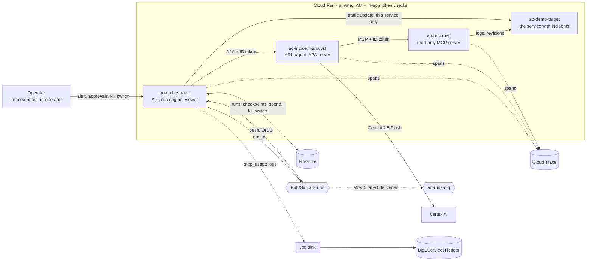
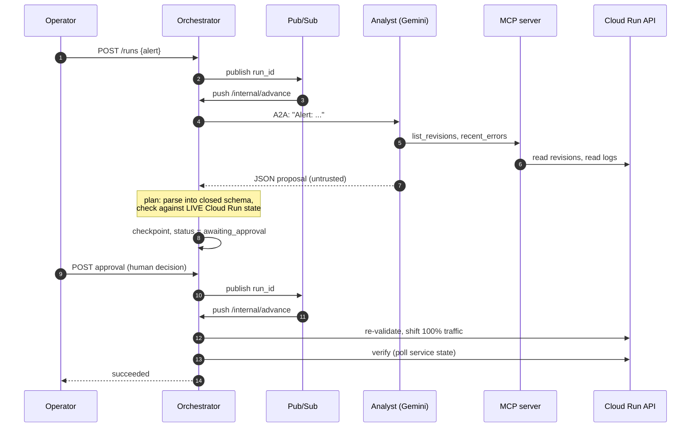
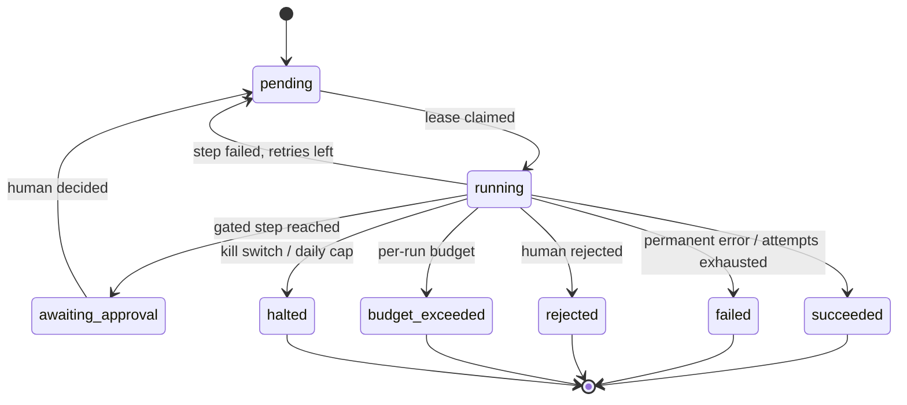

# Architecture

## Components (as deployed)

| Service | Identity | Can do | Cannot do |
|---|---|---|---|
| `ao-orchestrator` | `ao-orchestrator` | read/write run documents; publish to `ao-runs`; call the analyst; update **traffic of `ao-demo-target` only** | touch any other Cloud Run service; read logs |
| `ao-incident-analyst` | `ao-incident-analyst` | call Gemini; call the MCP server | read Firestore; change anything |
| `ao-ops-mcp` | `ao-ops-mcp` | read logs (project-wide `logging.viewer`, but the server only queries allow-listed services); read `ao-demo-target` | write anything |
| `ao-demo-target` | `ao-demo-target` | nothing (no permissions) | everything |
| Pub/Sub push | `ao-pubsub-push` | call `/internal/advance` | anything else |
| Operator | `ao-operator` (humans impersonate it) | call the orchestrator API | reach the MCP server or the analyst directly |

## One incident, end to end

## Run state machine

Every transition is a compare-and-set on `Run.version` in Firestore. The lease is two fields on the
run document, owned **per `advance()` call** (not per process), and kept alive by a heartbeat that
extends it without bumping `version`.

## What each guarantee rests on

| Guarantee | Mechanism | Where |
|---|---|---|
| A finished step never runs again | step output stored in the run document; engine skips checkpointed steps | `engine.py` |
| Only the in-flight step can repeat | at-least-once delivery; all effects behind it are idempotent | `engine.py`, `remediation.py` |
| Two workers never advance one run | lease via CAS; owner unique per call; heartbeat keeps it alive | `engine.py`, `store.py` |
| The model cannot act | reply -> closed schema -> live-state validation, before any human sees it | `remediation.py` |
| A human decision is required for a change | approval gate; first decision wins; re-validated at execution | `engine.py`, `workflows/triage.py` |
| Spend is bounded | per-run budget, platform daily cap, kill switch; all checked *before* the step | `engine.py`, `guard.py` |
| Identity is verified twice | Cloud Run IAM, then signature + issuer + expiry + **audience** in the app | `auth.py` |
| Every step is costed and traced | JSON `step_usage` log -> BigQuery; spans -> Cloud Trace | `obs.py`, `terraform/observability.tf` |

## How each part fails

| Failure | Behaviour |
|---|---|
| Worker crashes mid-step | lease expires; Pub/Sub redelivers; only that step re-runs |
| Duplicate / redelivered message | lease held -> `409` nack (retry later); terminal run -> ack no-op |
| Analyst or MCP unreachable | step raises -> `503` nack -> redelivery; after 3 attempts the run fails |
| Analyst answers without using its tools | refused inside the agent; A2A task state `FAILED` is raised by the client (not read as an answer) |
| Model returns bad / hostile JSON | `plan` fails the run before any approval is requested |
| Traffic moved while waiting for approval | execution refuses (`changed while awaiting approval`) |
| Rollback applied but the call errored | retry sees the target already serving and succeeds (`already_applied`) |
| Poison message | 5 deliveries, then `ao-runs-dlq` |
| Spend or runaway | per-run budget -> `budget_exceeded`; daily cap or kill switch -> `halted` |
| Trace export blocked | spans are lost, requests are not affected |
